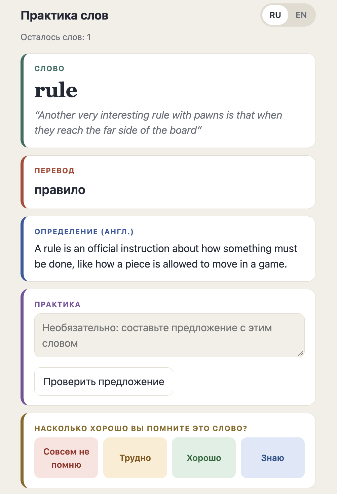
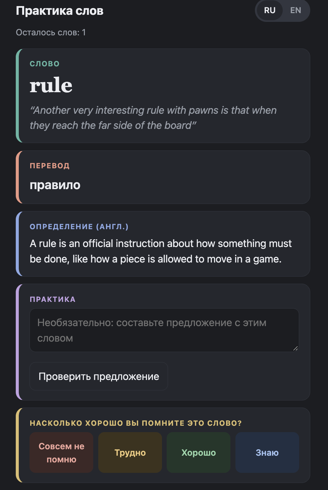
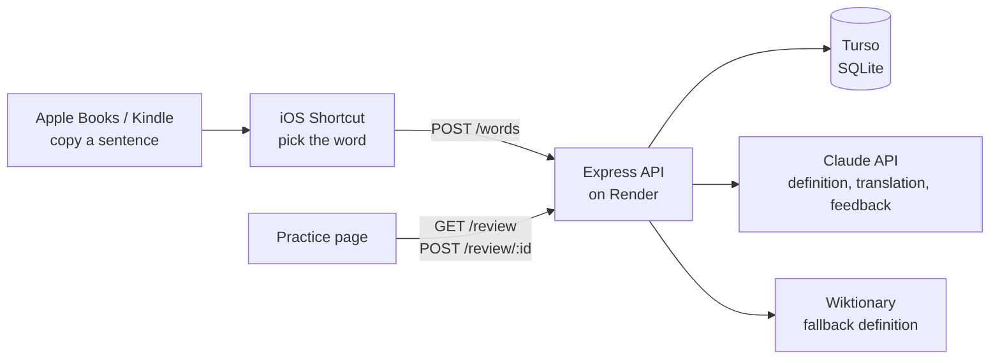

# Vocab API

Learn the English words you meet while reading. Copy a sentence in Apple Books or Kindle, run an iOS Shortcut, tap the word you didn't know, and a notification shows its meaning, in English or Russian. Saved words come back for review on a practice page, scheduled with spaced repetition, and an AI checks the sentences you write with them.

<p>
  
  
</p>

## Features

- **Save from any reading app.** An iOS Shortcut sends the word and the sentence it came from to the API.
- **Meaning in context.** Claude explains what the word means _in your sentence_. A dictionary gives every meaning; this gives the one you read. Wiktionary is the fallback if the AI is unavailable.
- **Russian translation.** Each word is translated using its sentence ("river bank" → берег, not банк). Notifications can show the translation instead of the English definition.
- **Spaced repetition.** A simplified SM-2 algorithm (the idea behind Anki) schedules each word: forgotten words come back tomorrow, known ones less and less often.
- **Practice page.** Shows the words due today with their definition, translation and original sentence. You rate how well you remembered each one.
- **AI sentence feedback.** Write your own sentence with the word and get short feedback plus an improved version.
- **Russian / English interface.** The practice page switches language with one tap and remembers the choice. Sentence feedback follows the page language.
- **Graceful degradation.** If the AI or the dictionary fails, the word is still saved; only the missing part is left empty.

## How it works



Apple Books and Kindle don't let other apps see the page, so the Shortcut reads the copied sentence from the clipboard. The sentence is the only context the API gets, and it is what lets the AI choose the right meaning.

## Tech stack

| Part       | Technology                                                                                |
| ---------- | ----------------------------------------------------------------------------------------- |
| API        | Node.js, Express 5                                                                        |
| Database   | SQLite via libSQL; a local file in development, [Turso](https://turso.tech) in production |
| AI         | Anthropic Claude API (`@anthropic-ai/sdk`, Claude Haiku)                                  |
| Dictionary | Wiktionary REST API                                                                       |
| Client     | iOS Shortcuts; a single-page HTML/CSS/JavaScript practice page                            |
| Hosting    | [Render](https://render.com)                                                              |

## Project structure

```
src/
  server.js      routes, API-key check, error handling
  db.js          database client and table setup
  ai.js          Claude prompts: definition, translation, quiz, sentence check
  dictionary.js  Wiktionary lookup (fallback definition)
  clean.js       tidies words and sentences from the share sheet / clipboard
  srs.js         spaced-repetition scheduling (SM-2)
public/
  practice.html  practice page, served at /practice.html
```

## Running it locally

You need Node.js 22 or newer.

```bash
git clone https://github.com/tatarynova/vocabAPI.git
cd vocabAPI
npm install
```

Create a `.env` file in the project folder (it is in `.gitignore` and must never be committed):

```bash
# Any long random string; generate one with: node -e "console.log(crypto.randomUUID())"
API_KEY=

# Leave both empty to use a local vocab.db file. Fill in to use Turso.
DATABASE_URL=
DATABASE_AUTH_TOKEN=

# Optional: enables AI definitions, translations and feedback.
ANTHROPIC_API_KEY=
```

Start the server; it restarts when you change a file or `.env`:

```bash
npm run dev
```

Check it's running at `http://localhost:3000/health`, then open `http://localhost:3000/practice.html`.

## API

Every route except `/health` and the practice page requires an `x-api-key` header matching `API_KEY`.

| Method | Path          | Body                                | What it does                                                             |
| ------ | ------------- | ----------------------------------- | ------------------------------------------------------------------------ |
| GET    | `/health`     |                                     | Status check; shows whether AI is enabled                                |
| POST   | `/words`      | `{ word, context, source, notify }` | Save a word. `notify: "ru"` makes `message` show the Russian translation |
| GET    | `/words`      |                                     | List all saved words                                                     |
| DELETE | `/words/:id`  |                                     | Delete a word                                                            |
| GET    | `/review`     |                                     | Words due for review (up to 20)                                          |
| POST   | `/review/:id` | `{ grade }`                         | Record recall: 0 forgot, 1 hard, 2 good, 3 easy                          |
| GET    | `/quiz/:id`   |                                     | AI fill-in-the-blank sentence for a word                                 |
| POST   | `/check/:id`  | `{ sentence, lang }`                | AI feedback on your sentence; `lang: "ru"` for Russian feedback          |

Example:

```bash
curl -X POST http://localhost:3000/words \
  -H 'Content-Type: application/json' \
  -H 'x-api-key: YOUR_KEY' \
  -d '{"word":"bank","context":"They sat on the river bank.","notify":"ru"}'
```

## The iOS Shortcut

The **Save Word** shortcut is built in the Shortcuts app:

1. **Receive** text input, and if there is none, **Get Clipboard**.
2. **Split Text** by spaces, then **Choose from List** to pick the word.
3. **Get Contents of URL**: `POST` to `https://YOUR-APP.onrender.com/words` with an `x-api-key` header and a JSON body of `word` (chosen item), `context` (the input), `source`, and optionally `notify` = `ru`.
4. **Get Dictionary Value** `message`, then **Show Notification**.

Assign it to **Back Tap** (Settings → Accessibility → Touch → Back Tap) so saving a word is: copy, double-tap the back of the phone, pick the word.

## Deploying to Render

1. Create a **Web Service** from this repository. Build command `npm install`, start command `npm start`.
2. Under **Environment**, add `API_KEY`, `DATABASE_URL`, `DATABASE_AUTH_TOKEN` and, optionally, `ANTHROPIC_API_KEY`.
3. Set the health check path to `/health`.

Render's free tier stops the service after 15 minutes without requests, so the first request after a break can take up to a minute. Its file system is not kept between restarts, which is why production data lives in Turso.

## Security

- Secrets live only in `.env` locally and in Render's environment settings, never in the code or the repository.
- All database queries use `?` placeholders, so user input can't change the SQL (no SQL injection).
- Values from requests that end up in AI prompts (such as the feedback language) are checked against an allowlist, to prevent prompt injection.

## What I'd add next

- Accounts, so several people can use one deployment with their own words
- Other languages for user to choose from
- Unit tests for the scheduling and text-cleaning functions
